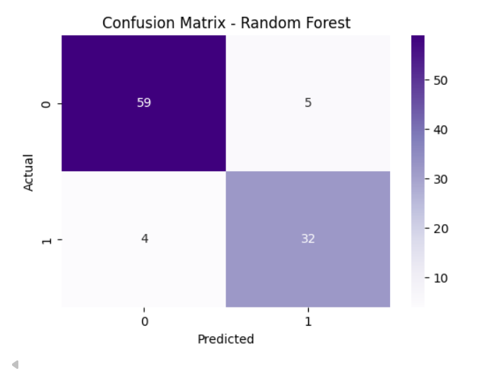
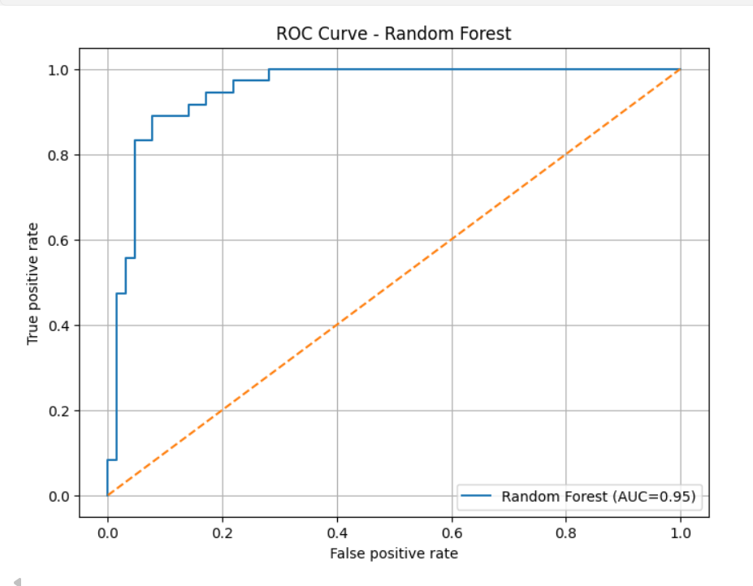
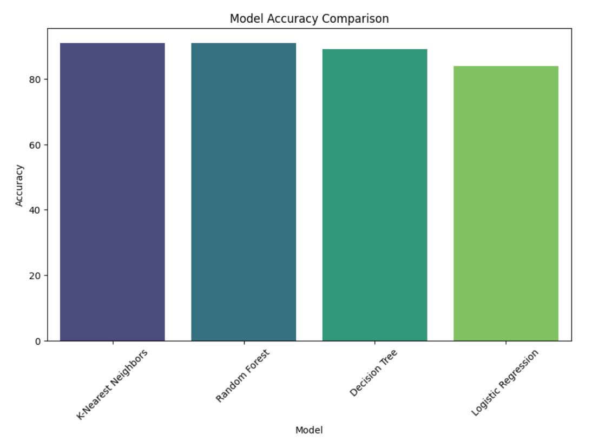

# Customer Insurance Purchase Prediction

## Project Overview

This project uses Machine Learning classification algorithms to predict whether a customer is likely to purchase insurance based on their age and estimated salary.

The goal is to compare different classification models and identify the best-performing model for insurance purchase prediction.

## Business Problem

An insurance company wants to understand customer purchasing behaviour and predict which customers are more likely to purchase insurance.

This project uses customer age and estimated salary to build a predictive model.

## Dataset Description

The dataset contains the following features:

| Feature | Description |
|---|---|
| Age | Customer's age |
| EstimatedSalary | Customer's estimated salary |
| Purchased | Whether the customer purchased insurance (0 = No, 1 = Yes) |

## Technologies Used

- Python 
- Pandas
- NumPy
- Matplotlib
- Seaborn
- Scikit-learn
- Jupyter Notebook

## Machine Learning Algorithms

The following classification algorithms were implemented:

1. Logistic Regression
2. K-Nearest Neighbors (KNN)
3. Support Vector Machine (SVM)
4. Decision Tree
5. Random Forest

## Model Performance Comparison

The models were evaluated using training accuracy, testing accuracy, and 5-fold cross-validation.

| Algorithm | Training Accuracy | Testing Accuracy | Cross-validation |
|---|---:|---:|---:|
| Logistic Regression | 84.67% | 84% | 84.25% |
| KNN | 91.33% | 91% | 89.75% |
| SVM | 85% | 82% | 84.50% |
| Decision Tree | 94.67% | 89% | 89.25% |
| Random Forest | 95% | 91% | 90.50% |

## Best Model

Random Forest achieved the highest cross-validation accuracy of 90.50%.

It also achieved 91% testing accuracy and an ROC-AUC score of 0.9514.

Therefore, Random Forest was selected as the best-performing model in this comparison.

## How to Run the Project

### 1. Clone the Repository 
     
```bash
git clone https://github.com/chithragnchithragn-collab/Customer-Insurance-Purchase-Prediction.git
```
## Project Visualizations

### Confusion Matrix



### ROC Curve



### Model Comparison




Customer Prediction Scenarios

The trained Random Forest model was tested using 8 customer scenarios.

Scenario| Age| Estimated Salary (₹)| Prediction
|---|---|---|---|
1| 30| 87,000| Unlikely to Purchase
2| 40| 0| Unlikely to Purchase
3| 40| 1,00,000| Likely to Purchase
4| 50| 0| Likely to Purchase
5| 18| 0| Unlikely to Purchase
6| 22| 6,00,000| Likely to Purchase
7| 35| 2,50,000| Likely to Purchase
8| 60| 10,00,000| Likely to Purchase

Assumption: No Salary is represented as ₹0.

Note: These are model predictions, not guaranteed customer decisions. Predictions outside the training data range should be interpreted cautiously.


## Hypotheses and Observations

Hypotheses

- Age may influence a customer's decision to purchase insurance.
- Estimated salary may influence purchasing behaviour.
- A combination of age and estimated salary may help predict insurance purchases.

Observations

- The Random Forest model achieved 91% test accuracy.
- The model predicted different outcomes for customers with different age and salary combinations.
- Age and estimated salary together were used to make predictions.
- Some test scenarios had salary values that may be outside the training data range.

Conclusion

The project demonstrates how machine learning classification algorithms can help predict customer insurance purchase behaviour using customer age and estimated salary.

## Lessons Learned

Through this project, I learned:

1. How to load and explore a dataset using Pandas.
2. How to clean and preprocess data.
3. How to perform train-test splitting.
4. Why feature scaling is important for machine learning.
5. How classification algorithms work.
6. How to train and evaluate multiple ML models.
7. How to compare models using accuracy and cross-validation.
8. How to evaluate a model using a confusion matrix and ROC curve.
9. How to save and load trained models using Pickle.
10. How to make predictions using new customer inputs.
11. How to manage and publish a machine learning project using Git and GitHub

## Real-World Applications

This machine learning project can be applied in the following areas:

1. Insurance Companies: Identify customers who may be interested in purchasing insurance.
2. Customer Analysis: Understand customer behaviour based on age and estimated salary.
3. Marketing: Help businesses identify potential customers for targeted campaigns.
4. Business Decision-Making: Support data-driven marketing and customer engagement strategies.

Note: The model provides predictions to support decision-making, not guaranteed customer outcomes.


